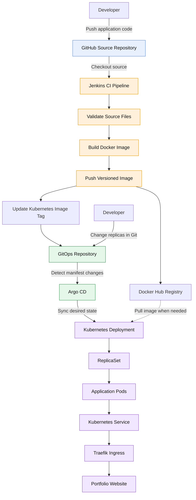

# End-to-End DevOps CI/CD and GitOps Project

## Overview

This project demonstrates an automated CI/CD and GitOps workflow for deploying a portfolio website to a local Kubernetes cluster.

Jenkins builds the application’s Docker image and pushes versioned images to Docker Hub. It then updates the image tag in a separate GitOps repository. Argo CD detects the manifest change and synchronizes the desired state with Kubernetes.

## Technology Stack

- **Source Control:** Git and GitHub
- **CI/CD:** Jenkins
- **Containerization:** Docker
- **Container Registry:** Docker Hub
- **Orchestration:** Kubernetes (Rancher Desktop/K3s)
- **GitOps:** Argo CD
- **Ingress:** Traefik

## Architecture Diagram



### Two Important Workflows

**CI/CD workflow:** A source-code change triggers the Jenkins pipeline, which builds and pushes the Docker image and updates the GitOps manifest. Argo CD then synchronizes the change.

**GitOps workflow:** A Kubernetes manifest change, such as adjusting the replica count, can be synchronized directly by Argo CD without running Jenkins.

*Note: The diagram represents the intended image-pull flow; Kubernetes pulls images according to the Deployment configuration and node cache.*

## Repositories

- **Application source:** https://github.com/AravindaKumar-0/devops-portfolio
- **GitOps manifests:** https://github.com/AravindaKumar-0/devops-portfolio-gitops

## Key Features

- Automated Docker image build and registry push through Jenkins.
- Versioned Docker images using Jenkins build numbers.
- Automated Kubernetes manifest updates.
- Argo CD synchronization with automated sync, pruning, and self-healing enabled.
- Kubernetes replica scaling managed through GitOps.
- Local Kubernetes deployment without requiring a billable AWS cluster.

## Kubernetes Deployment

The GitOps repository contains the Kubernetes manifests:

- `k8s/deployment.yaml`
- `k8s/service.yaml`
- `k8s/ingress.yaml`

Argo CD monitors the GitOps repository and reconciles the cluster with the desired configuration.

## Accessing the Application Locally

The portfolio website is accessed through Traefik using the local hostname `portfolio.local`.

The local setup requires the appropriate hosts-file entry and a running port-forward to the Traefik service:

```bash
kubectl port-forward -n kube-system svc/traefik 8000:80
```

Then open:

http://portfolio.local:8000/

Keep the port-forward terminal running while accessing the website.

## Challenges and Lessons Learned

- **CI versus GitOps:** Application image changes go through Jenkins, while Kubernetes manifest changes can be synchronized directly by Argo CD.
- **Image versioning:** Unique build-number tags make application deployments easier to track.
- **GitOps reconciliation:** Argo CD compares the Git repository with the live cluster and applies the desired configuration.
- **Kubernetes scaling:** Changing the Deployment replica count allows Kubernetes to create or remove Pods to match the desired state.
- **Networking:** Local access depends on the correct hostname configuration, Ingress routing, and port-forwarding setup.

## Troubleshooting Notes

### 1. Website Not Accessible

**Checks:**
- Verify the Kubernetes Pods are running.
- Confirm the Service and Ingress resources exist.
- Check that the Traefik port-forward is active.
- Verify that `portfolio.local` resolves to `127.0.0.1` in the local hosts file.

### 2. Jenkins Pipeline Failure

**Checks:**
- Review the failed stage in the Jenkins console output.
- Verify that the required source files exist.
- Check Docker Hub credentials and registry push errors.
- Verify that GitHub credentials permit the GitOps repository update.

### 3. Argo CD Not Reflecting a Change

**Checks:**
- Confirm the change was committed and pushed to the GitOps repository.
- Check the Argo CD Application sync status.
- Review the application health status and synchronization errors.
- Verify that the correct manifest path is configured.

### 4. Replica Count Changes

When the Deployment replica count changes, Kubernetes creates or removes Pods to match the desired state. Argo CD can apply replica-count changes from Git without requiring a Jenkins build.

### 5. GitHub Webhook

The webhook endpoint must be reachable from GitHub's servers. A local `localhost` URL is not sufficient. If using a temporary Cloudflare Tunnel, keep it running and verify successful webhook delivery in GitHub's Recent Deliveries section.

## Lessons Learned

- CI and GitOps serve different purposes in an automated deployment workflow.
- Versioned container images improve deployment traceability.
- Argo CD reconciles Kubernetes resources against the desired state stored in Git.
- Kubernetes Deployments manage ReplicaSets and application Pods.
- Troubleshooting should begin with the logs and status of the component responsible for the failure.


## Future Improvements

- Verify and document successful GitHub webhook delivery.
- Add Prometheus and Grafana monitoring.
- Add automated application tests and deployment notifications.
- Improve deployment security and secret management.
